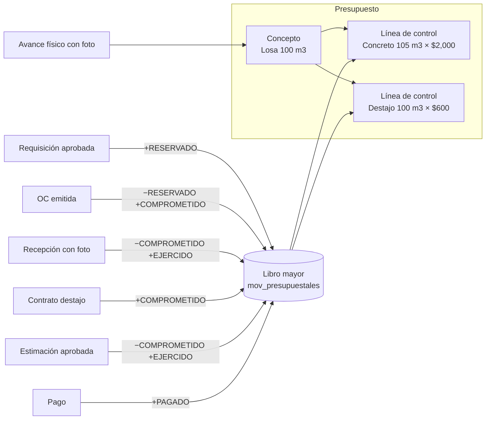
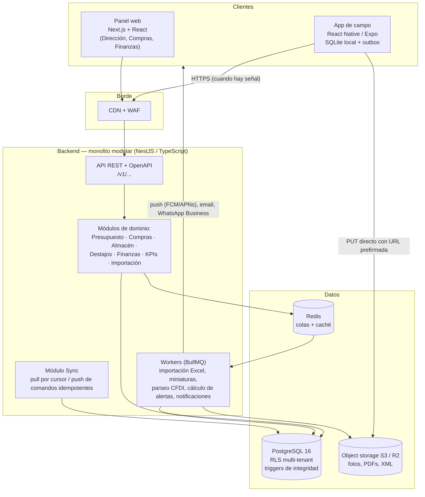
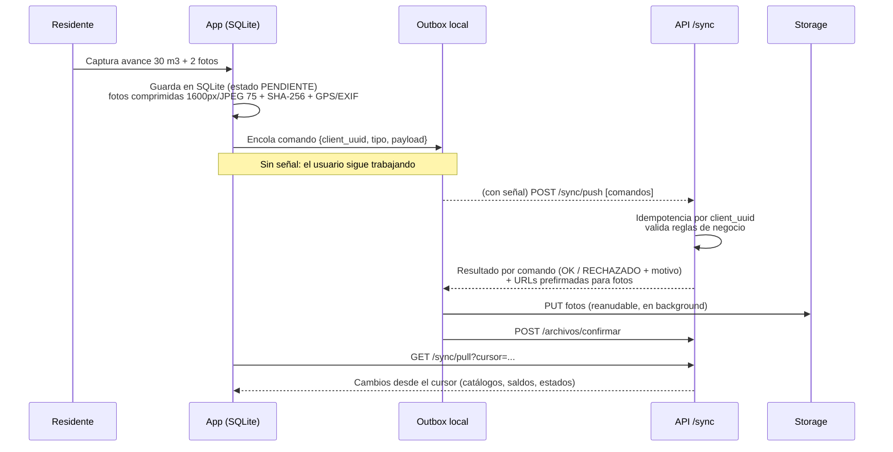
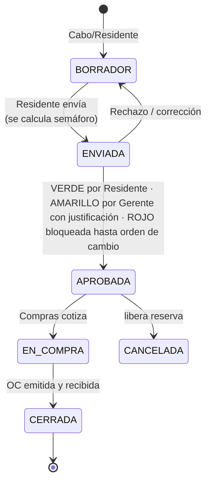
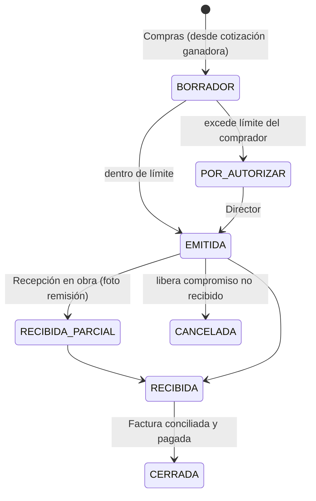
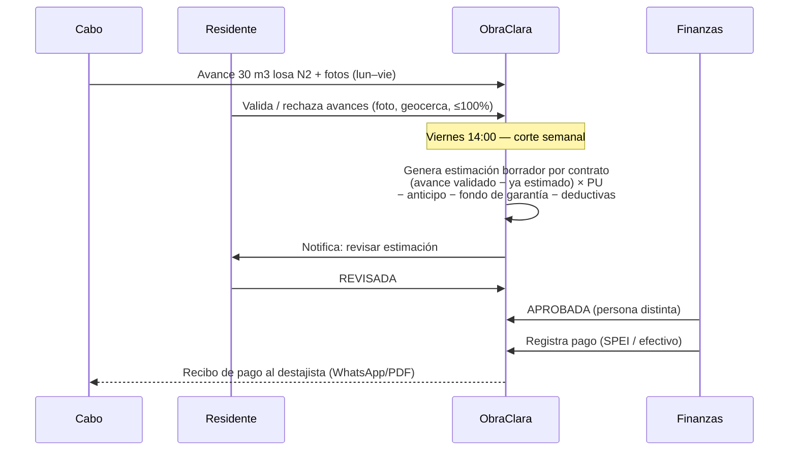
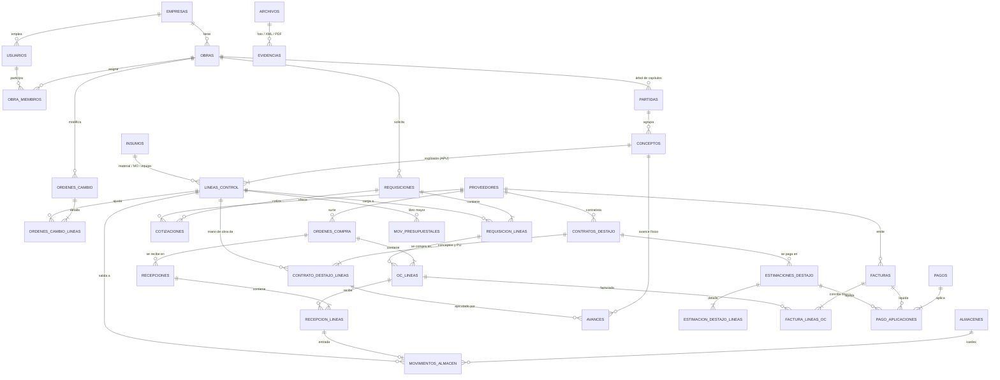
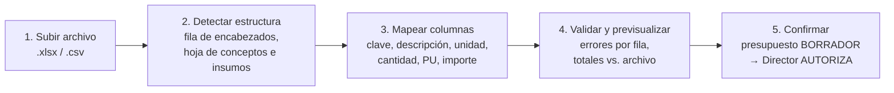

# ObraClara — Propuesta técnica de arquitectura, datos y producto

> **Para quién:** constructoras pequeñas y medianas (5–80 empleados de oficina, 1–15 obras simultáneas) que hoy operan con Excel, WhatsApp y un presupuesto en Neodata/Opus que nadie consulta después de licitar.
>
> **Principio rector:** *reconciliación continua* entre lo **presupuestado**, lo **ejecutado físicamente** y lo **pagado**. Todo peso que sale y todo bulto que se mueve se ancla a un renglón del presupuesto en el momento en que ocurre, no al cierre de mes.

| Entregable | Archivo |
|---|---|
| Esta propuesta (arquitectura, roles, reglas, MVP) | `README.md` |
| Esquema PostgreSQL ejecutable (tablas, triggers, vistas KPI, RLS) | [`db/schema.sql`](db/schema.sql) |
| Prueba de punta a punta de las reglas de negocio | [`db/demo_flujo.sql`](db/demo_flujo.sql) |
| Plantilla de importación de presupuesto | [`importacion/plantilla_presupuesto.csv`](importacion/plantilla_presupuesto.csv) |

```bash
createdb obraclara
psql -d obraclara -v ON_ERROR_STOP=1 -f db/schema.sql
psql -d obraclara -v ON_ERROR_STOP=1 -f db/demo_flujo.sql   # corre en una transacción y hace ROLLBACK
```

---

## 0. La idea central en una imagen

Toda la plataforma gira alrededor de una sola estructura: la **línea de control** (concepto × insumo) y un **libro mayor presupuestal** append‑only donde cada documento operativo deja huella.



```
disponible = vigente − (reservado + comprometido + ejercido)
```

- **Vigente** = línea base autorizada + órdenes de cambio autorizadas (nunca edición directa).
- **Pagado** es una dimensión de flujo de efectivo: no consume saldo (ya lo consumió el ejercido), pero permite ver deuda con proveedores y destajistas por concepto.
- **Avance físico** se registra contra el concepto, con foto, y es la otra mitad de la conciliación: *¿lo que ya gasté corresponde a lo que ya construí?*

Si un gasto no se puede asociar a una línea de control, **no se puede registrar**. Ese es el antídoto contra los “sobrecostos fantasma”.

---

## 1. Arquitectura del sistema y stack tecnológico

### 1.1 Vista general



**Decisión principal: monolito modular, no microservicios.** El dominio es altamente transaccional y relacional (una recepción toca OC, almacén y libro mayor en la misma transacción). Un equipo de 3–6 personas no debe pagar el costo operativo de transacciones distribuidas. Los módulos se separan por carpeta y por esquema lógico, con interfaces explícitas, para poder extraer uno (p. ej. Importación o Notificaciones) si un día lo amerita.

### 1.2 Stack recomendado

| Capa | Elección | Por qué | Alternativa válida |
|---|---|---|---|
| **Base de datos** | **PostgreSQL 16** (AWS RDS / Neon / Supabase) | Integridad referencial fuerte, FKs compuestas, triggers, `numeric` exacto para dinero, RLS para multi‑tenant, JSONB para metadatos, vistas para KPIs. | — (no recomendamos NoSQL para el núcleo financiero) |
| **Backend** | **NestJS + TypeScript**, Drizzle ORM (o Kysely) | Un solo lenguaje con web y móvil; tipos compartidos (`@obraclara/contracts`); Drizzle no esconde el SQL, importante con triggers y vistas. | Django + DRF (si el equipo es Python) |
| **Jobs / colas** | BullMQ sobre Redis | Importaciones pesadas, miniaturas, alertas nocturnas, reintentos. | pg‑boss (sin Redis) |
| **Archivos** | S3 o Cloudflare R2 + URLs prefirmadas | El móvil sube directo al bucket; el API nunca recibe binarios. R2 elimina costo de egreso para galerías de fotos. | MinIO on‑prem |
| **Panel web** | **Next.js (App Router) + React + TanStack Query/Table + shadcn/ui + Recharts/ECharts** | Tablas densas tipo hoja de cálculo (presupuestos de miles de renglones con virtualización), dashboards, SSR para enlaces compartibles. | Vite + React SPA |
| **App de campo** | **React Native (Expo, prebuild)** + **expo-sqlite / WatermelonDB** + `expo-camera`, `expo-location`, `expo-image-manipulator` | El repositorio actual ya es React Native: se reutiliza conocimiento, navegación y componentes. Offline-first real con SQLite. | PowerSync (sincronización Postgres↔SQLite gestionada) |
| **Autenticación** | Auth propia con JWT corto + refresh rotatorio, o servicio gestionado (Clerk / Auth0 / Supabase Auth) | Login por teléfono con OTP para cabos (sin correo), SSO para oficina. | Keycloak (on‑prem) |
| **Observabilidad** | OpenTelemetry → Grafana/Datadog, Sentry en web y móvil | Errores de sincronización en campo son el principal riesgo operativo. | — |
| **Infraestructura** | Contenedores en AWS ECS Fargate (o Render/Fly.io para el MVP), Terraform | Escala horizontal del API; base gestionada con backups PITR. | — |

> **Nota sobre el repo actual:** hoy contiene una app React Native con Firebase (Firestore). Para ObraClara recomendamos **no** usar Firestore como fuente de verdad: el modelo es relacional y contable (FKs, sumas exactas, transacciones multi‑tabla). Firebase puede seguir usándose para push (FCM) y, si se desea, para autenticación telefónica.

### 1.3 Panel web administrativo

- **Módulos:** Obras · Presupuesto (árbol partida → concepto → insumo, con columnas vigente/reservado/comprometido/ejercido/pagado/disponible) · Requisiciones (bandeja por semáforo) · Cotizaciones (cuadro comparativo) · Órdenes de compra · Almacén (kardex, existencias) · Destajos (contratos, estimaciones, fondo de garantía) · Facturas (carga de XML CFDI, conciliación 3 vías) · Pagos (programación semanal) · Dashboard ejecutivo · Importación · Configuración.
- **UX clave:** grillas tipo Excel (copiar/pegar, filtros, totales en vivo), drill‑down de cualquier cifra hasta el documento y la foto que la originó (“¿por qué este concepto lleva 112 %?” → 3 clics → la remisión fotografiada).
- **Bandejas por rol** en lugar de menús: cada usuario abre el sistema y ve “lo que espera de mí”.

### 1.4 App de campo (residente / cabo) — offline primero

La obra típica tiene señal intermitente (sótanos, zonas rurales, estructuras de concreto). La app debe funcionar **un día completo sin conexión**.

**Patrón: réplica parcial de lectura + bandeja de salida de comandos.**



Reglas de diseño del sync:

1. **Los datos de campo son comandos, no ediciones de registros compartidos** (“reporté 30 m3”, “recibí 50 m3 con remisión X”). Esto elimina casi todos los conflictos de merge: el servidor es la autoridad y responde aceptado/rechazado con motivo.
2. **Idempotencia:** cada comando lleva `client_uuid` (columna `UNIQUE` en `requisiciones`, `recepciones`, `avances`, `movimientos_almacen`). Reenviar es seguro.
3. **Réplica de lectura acotada:** sólo las obras asignadas al usuario, sus conceptos/líneas de control, saldos resumidos, OCs pendientes de recibir y contratos de destajo. Unos pocos MB.
4. **Validación en dos niveles:** la app pre‑calcula el semáforo con los saldos locales (respuesta inmediata al residente), el servidor recalcula con bloqueo y datos frescos (decisión definitiva).
5. **Evidencia robusta:** captura sólo desde cámara (no galería) para avances y recepciones, marca de agua con fecha/obra/GPS, hash SHA‑256 para detectar fotos recicladas, verificación de geocerca (radio configurable por obra).
6. **Subida de fotos desacoplada** de los datos: el registro llega aunque la foto tarde horas; el avance no puede pasar a `VALIDADO` hasta que la foto esté confirmada.
7. **Indicador de sincronización visible** (“3 pendientes · última sync 10:42”), y nada se borra localmente hasta recibir confirmación.

### 1.5 Backend y API

- **API REST versionada** (`/v1`), contrato OpenAPI generado y tipos compartidos con web/móvil. Endpoints orientados a acciones de negocio, no CRUD ciego: `POST /requisiciones/{id}/enviar`, `POST /ordenes-compra/{id}/emitir`, `POST /contratos/{id}/estimaciones:generar`.
- **Reglas críticas en la base de datos** (triggers y FKs de `schema.sql`) **y** en la capa de servicio. La base es la última línea de defensa: aunque haya un bug en el API, una importación manual o un script de soporte, no se puede crear un gasto huérfano ni editar el libro mayor.
- **Multi‑tenant** con columna `empresa_id` + Row Level Security. El API abre cada transacción con `SET LOCAL oc.empresa_id = '<uuid>'`.
- **Auditoría:** tabla `auditoria` (antes/después en JSONB) alimentada por trigger genérico o por la capa de servicio; el libro mayor es inmutable por diseño.
- **Concurrencia:** las validaciones de saldo toman `SELECT … FOR UPDATE` sobre la línea de control, de modo que dos requisiciones simultáneas no puedan “gastar” el mismo saldo.
- **Archivos:** tabla `archivos` (metadatos, hash, GPS, EXIF) + `evidencias` (vínculo polimórfico con la entidad). Miniaturas generadas por worker; ciclo de vida en S3 (fotos > 2 años a almacenamiento frío).
- **Integraciones fase 2:** parseo de CFDI 4.0 (XML) y validación de estatus ante SAT, exportación de pólizas a CONTPAQi/Aspel, layout de pagos bancarios.

### 1.6 Requisitos no funcionales

| Tema | Objetivo |
|---|---|
| Disponibilidad | 99.5 % en MVP, 99.9 % en producción |
| Respaldo | PITR 7 días + snapshot diario 30 días; bucket con versionado |
| Seguridad | TLS, cifrado en reposo, MFA para Finanzas/Dirección, URLs de archivo prefirmadas de vida corta |
| Rendimiento | Presupuesto de 5,000 renglones navegable < 1 s (virtualización + vistas indexadas); sync de un día de trabajo < 30 s en 3G |
| Costo infra MVP | ~USD 150–300/mes (RDS t4g.medium, Fargate 2 tareas, Redis pequeño, R2) |

---

## 2. Roles de usuario y flujos de permisos

### 2.1 Roles

| Rol | Alcance | Qué hace | Qué **no** puede hacer |
|---|---|---|---|
| **Cabo** | Obra asignada | Captura avances con foto, solicita material (borrador), registra salidas de almacén a concepto | Validar sus propios avances, ver precios ni importes |
| **Residente de obra** | Obra(s) asignada(s) | Envía requisiciones, **valida avances** de cabos, recibe material con foto, revisa estimaciones de destajo, solicita órdenes de cambio | Emitir OC, aprobar pagos, modificar presupuesto |
| **Gerente de obra** *(opcional; si no existe lo cubre Dirección)* | Varias obras | Autoriza requisiciones en AMARILLO, revisa estimaciones | Pagar |
| **Compras** | Empresa | Cotiza, compara, emite OC dentro de su límite, da seguimiento a entregas | Emitir OC sin requisición aprobada; cambiar la línea de control de una requisición |
| **Almacén** | Obra | Recepciones, salidas, traspasos, inventarios físicos | Ajustes de inventario sin autorización |
| **Finanzas / Contabilidad** | Empresa | Carga y concilia facturas (3 vías), aprueba estimaciones, programa y registra pagos, libera fondos de garantía | Crear requisiciones u OC; validar avances |
| **Director / Dueño** | Empresa | Dashboard, autoriza presupuesto y órdenes de cambio, autoriza excepciones ROJAS, configura tolerancias | — (todo queda auditado) |
| **Admin** | Empresa | Usuarios, catálogos, importaciones | Operaciones financieras |

Un usuario puede tener varios roles por obra (en constructoras pequeñas el residente suele ser también almacenista). El modelo `obra_miembros(obra_id, usuario_id, rol)` lo permite; las **reglas de segregación** se aplican por persona, no por rol (p. ej. quien captura un avance no lo valida; quien revisa una estimación no la aprueba).

### 2.2 Matriz de permisos (MVP)

`C` crear · `E` enviar · `V` validar/revisar · `A` aprobar/autorizar · `R` ver · — sin acceso

| Documento | Cabo | Residente | Compras | Almacén | Finanzas | Director |
|---|---|---|---|---|---|---|
| Presupuesto / líneas de control | R (sin $) | R | R | R (sin $) | R | **A** |
| Orden de cambio | — | C, E | R | — | R | **A** |
| Requisición | C | C, E, A (VERDE) | R | R | R | A (AMARILLO/ROJO) |
| Cotización / OC | — | R | C, E, A (≤ límite) | R | R | A (> límite) |
| Recepción | — | C | R | C | R | R |
| Salida de almacén | C | C | — | C | R | R |
| Avance físico | C | C, **V** | — | — | R | R |
| Contrato de destajo | — | C | R | — | V | **A** |
| Estimación de destajo | — | **V** (revisa) | — | — | **A** | R |
| Factura | — | — | R | — | C, V | R |
| Pago | — | — | — | — | C, A | R (A si > límite) |

Los **límites de autorización** (`usuarios.limite_autorizacion`) escalan automáticamente: una OC de $380,000 emitida por un comprador con límite de $150,000 queda `POR_AUTORIZAR` y le llega al Director.

### 2.3 Flujos principales

**Material: requisición → OC → recepción → factura → pago**





**Destajo: contrato → avance con foto → estimación semanal → pago**



---

## 3. Modelo entidad‑relación

### 3.1 Diagrama (entidades núcleo)



### 3.2 Tablas clave

| Tabla | Propósito | Campos esenciales |
|---|---|---|
| `obras` | Proyecto; contiene tolerancias de control | `monto_contrato`, `presupuesto_estado`, `tol_rojo_pct`, `tol_precio_pct`, `tol_anticipo_pts`, `lat/lng/radio_geocerca_m` |
| `partidas` | Árbol de capítulos (Preliminares › Cimentación › Zapatas) | `parent_id`, `clave` |
| `conceptos` | Renglón del catálogo de obra (unidad, cantidad, PU) | `cantidad_base`, `pu_costo_base`, `pu_venta`, `cantidad_vigente`, `pu_costo_vigente`, `es_extraordinario` |
| `lineas_control` | **Concepto × insumo**: la unidad mínima de control presupuestal | `insumo_id`, `cantidad_base`, `precio_base`, `cantidad_vigente`, `precio_vigente` |
| `ordenes_cambio(+_lineas)` | Única vía para modificar el presupuesto autorizado (aditiva, deductiva, extraordinario, traspaso neutro) | `tipo`, `delta_cantidad`, `nuevo_precio`, `autorizado_por` |
| `requisiciones(+_lineas)` | Solicitud de material/servicio | `linea_control_id` **NOT NULL**, `semaforo`, `validacion` (snapshot JSON), `justificacion`, `orden_cambio_id` |
| `cotizaciones(+_lineas)` | Comparativo por requisición | `proveedor_id`, `precio_unitario`, `dias_entrega` |
| `ordenes_compra` / `oc_lineas` | Compromiso con proveedor | `requisicion_linea_id` **NOT NULL**, misma `linea_control_id` (FK compuesta), `cantidad_recibida`, `semaforo_precio` |
| `recepciones(+_lineas)` | Entrada física con foto de remisión | `cantidad_aceptada`, `cantidad_rechazada`, `motivo_rechazo`, GPS |
| `movimientos_almacen` | Kardex (entradas, salidas a concepto, traspasos, ajustes) | `concepto_id/linea_control_id` obligatorios en salidas, `cargo_a_contratista` |
| `contratos_destajo(+_lineas)` | Precio unitario pactado con el destajista por concepto | `pct_fondo_garantia`, `monto_anticipo`, `pct_amortizacion`, `cantidad_contratada`, `pu_destajo` |
| `avances` | Avance físico incremental con evidencia | `cantidad`, `estado`, `capturado_por`, `validado_por`, GPS |
| `estimaciones_destajo(+_lineas, _deductivas)` | Pago periódico al destajista | `subtotal`, `amortizacion_anticipo`, `retencion_fg`, `deductivas`, `neto_a_pagar` |
| `facturas` / `factura_lineas_oc` | CFDI conciliado contra OC y recepción | `uuid_cfdi` UNIQUE, `total`, cantidad/importe por línea de OC |
| `pagos` / `pago_aplicaciones` | Salida de dinero aplicada a factura **o** estimación | `importe`, `CHECK` exactamente un destino |
| `mov_presupuestales` | **Libro mayor presupuestal** append‑only | `linea_control_id`, `etapa`, `cantidad`, `importe`, `doc_tipo/doc_id/doc_linea_id` |
| `archivos` / `evidencias` | Metadatos de binarios en S3 y su vínculo a cualquier documento | `sha256`, `tomada_en`, `lat/lng`, `entidad_tipo/entidad_id` |
| `alertas`, `auditoria` | Señales de desvío y bitácora | — |

El DDL completo, con tipos, checks y comentarios, está en [`db/schema.sql`](db/schema.sql).

### 3.3 Reglas de integridad contra los “sobrecostos fantasma”

Un sobrecosto fantasma es dinero que salió sin que nadie pueda decir a qué parte de la obra corresponde. Se elimina con nueve reglas, todas implementadas en la base de datos:

| # | Regla | Implementación |
|---|---|---|
| 1 | **No existe gasto sin línea de control.** Requisiciones, OCs, contratos de destajo y salidas de almacén llevan `concepto_id` y `linea_control_id` obligatorios. | `NOT NULL` + `CHECK` en `movimientos_almacen` |
| 2 | **La línea de control pertenece al concepto y el concepto a la obra del documento.** Imposible cargar a la obra B un material comprado para la obra A. | FKs compuestas `(obra_id, concepto_id, linea_control_id) → lineas_control(obra_id, concepto_id, id)` |
| 3 | **Herencia estricta de la imputación.** Una línea de OC lleva exactamente la misma línea de control que la requisición que la originó; Compras no puede “mover” el gasto. | FK `(requisicion_linea_id, linea_control_id) → requisicion_lineas(id, linea_control_id)` |
| 4 | **Sin requisición aprobada no hay OC; sin OC emitida no hay recepción; sin recepción no hay factura; sin factura/estimación aprobada no hay pago.** | Triggers `trg_oc_estado`, `trg_recepcion_linea`, `trg_factura_linea_oc`, `trg_pago_aplicacion` |
| 5 | **Conciliación de 3 vías:** cantidad facturada ≤ recibida; precio facturado ≤ precio de OC; recibido ≤ ordenado × (1 + tolerancia). | Triggers de recepción y factura |
| 6 | **Presupuesto autorizado congelado.** La línea base es inmutable; lo vigente sólo cambia vía orden de cambio autorizada, y los traspasos deben ser neutros en importe. | `trg_congelar_presupuesto`, `fn_aplicar_orden_cambio` |
| 7 | **Libro mayor inmutable.** Nada se edita ni borra; una corrección es un contra‑asiento con referencia al documento. | `trg_inmutable` en `mov_presupuestales` |
| 8 | **Almacén sin “consumos genéricos”.** Cada salida dice a qué concepto se fue; si es distinto del que pagó el material, se genera una reclasificación de costo automática. No se puede sacar más de lo que hay. Ajustes requieren motivo y autorizador. | `trg_mov_almacen` |
| 9 | **No existe la partida “Varios / Imprevistos” libre.** Los indirectos de obra (renta de bodega, vigilancia, fletes) se presupuestan como conceptos explícitos; un gasto no previsto obliga a una orden de cambio *extraordinario*, que queda visible para Dirección. | Política de importación + regla 1 |

Adicionalmente: `facturas.uuid_cfdi` único (no se captura dos veces la misma factura), `client_uuid` único (no se duplican capturas de campo al re‑sincronizar), segregación de funciones en avances y estimaciones.

---

## 4. Lógica de control y reglas de negocio

### 4.1 Validación previa de requisiciones (semáforo)

Se ejecuta **al enviar** (informativo, para que el residente vea el resultado de inmediato) y **otra vez al aprobar**, dentro de la misma transacción que crea la reserva y con bloqueo sobre la línea de control (`fn_validar_linea_requisicion` + `trg_requisicion_estado`).

**Entradas:** línea de control, cantidad solicitada, precio estimado (último precio de OC o precio presupuestado).

```text
función validar(linea, cantidad, precio):
    BLOQUEAR linea_control                         # serializa requisiciones concurrentes
    vigente_q, vigente_$  ← cantidad/importe vigentes (base + órdenes de cambio)
    consumido_q, _$       ← reservado + comprometido + ejercido (libro mayor)
    pct_q  ← (consumido_q + cantidad)          / vigente_q × 100
    pct_$  ← (consumido_$ + cantidad × precio) / vigente_$ × 100
    pct_precio  ← (precio − precio_vigente) / precio_vigente × 100
    pct_fisico  ← avance físico validado del concepto

    semáforo ← VERDE
    si max(pct_q, pct_$) > 100 + tol_rojo          → ROJO      "Excede presupuesto"
    si no, si max(pct_q, pct_$) > 100 + tol_amarillo → AMARILLO "Sobregiro dentro de tolerancia"
    si pct_precio > tol_precio                      → al menos AMARILLO "Precio arriba de presupuesto"
    si pct_q − pct_fisico > tol_anticipo y pct_q > 50 → al menos AMARILLO "Consumo anticipado"
    devolver semáforo + snapshot JSON (todas las cifras y motivos)
```

**Qué ocurre según el resultado:**

| Semáforo | Condición típica (configurable por obra) | Efecto |
|---|---|---|
| 🟢 **VERDE** | Cabe en el saldo, precio razonable, consumo acorde al avance | El residente la aprueba; se crea la **reserva** y pasa a Compras. |
| 🟡 **AMARILLO** | Sobregiro ≤ 5 %, precio > 8 % sobre presupuesto, o material pedido 30 pts por encima del avance físico | Exige **justificación escrita** + autorización del Gerente/Director (`autoriza_excepcion_por`). Queda registrada como excepción en el dashboard. |
| 🔴 **ROJO** | Sobregiro > 5 % de volumen o importe | **Bloqueada.** No se puede aprobar. El sistema propone: (a) *traspaso* desde otra línea con saldo (neutro en importe), (b) *aditiva* si el cliente pagará el adicional, o (c) *extraordinario* para un insumo no presupuestado. La orden de cambio requiere autorización de Dirección y queda ligada a la requisición. |

> La regla de **consumo anticipado** es la que atrapa el robo hormiga y el desperdicio: si la losa lleva 0 % de avance y ya se pidió el 95 % del concreto, algo no cuadra aunque “aún haya presupuesto”.

Al emitir la OC se ejecuta un segundo control, el **semáforo de precio** (`oc_lineas.semaforo_precio`), que separa la *variación de precio* (Compras pagó más caro) de la *variación de volumen* (la obra consumió más). Si el precio real deja la línea con saldo negativo, se levanta una alerta `SOBRECOSTO_PRECIO` sin bloquear una OC ya negociada.

**Ejemplo real (ejecutado en `demo_flujo.sql`)** — Losa de 100 m3, concreto presupuestado 105 m3 × $2,000:

| Paso | Solicitud | Consumo proyectado | Avance físico | Resultado |
|---|---|---|---|---|
| REQ‑001 | 50 m3 | 47.6 % | 0 % | 🟢 VERDE → reserva $100,000 |
| OC‑001 | 50 m3 × $2,100 | — | — | Compromiso $105,000, precio 🟡 (+5 %) |
| REQ‑002 | 70 m3 | 114.3 % volumen / 116.7 % importe | 0 % | 🔴 ROJO → bloqueada |
| Orden de cambio | +21 m3 (sobre‑espesor) | 95.2 % de 126 m3 | 0 % | 🟡 AMARILLO (consumo anticipado) → aprobada con justificación |

### 4.2 Estimaciones de destajo (pago semanal a contratistas)

**Datos del contrato:** conceptos con `cantidad_contratada` y `pu_destajo`, `% fondo de garantía` (típico 5 %), `monto_anticipo` y `% amortización` (normalmente = anticipo / monto del contrato).

**Ciclo semanal:**

1. **Lunes a viernes — captura.** El cabo reporta avances incrementales por concepto (“30 m3 de losa, nivel 2, ejes 3‑5”) con ≥ 1 foto tomada desde la app, GPS dentro de la geocerca.
2. **Validación por el residente** (persona distinta al capturista). El sistema impide validar si: no hay foto confirmada, la foto ya se usó en otro avance (hash), o el acumulado rebasaría el volumen vigente del concepto.
3. **Viernes, corte — generación automática** (`fn_generar_estimacion_destajo`), por cada línea de contrato:

```text
acumulado_validado = Σ avances VALIDADOS hasta la fecha de corte
ya_estimado        = Σ cantidad_periodo de estimaciones previas no canceladas
cantidad_periodo   = min(acumulado_validado, cantidad_contratada) − ya_estimado     (sólo si > 0)
importe            = cantidad_periodo × pu_destajo

subtotal              = Σ importe
amortización_anticipo = min(subtotal × %amortización, saldo_anticipo_pendiente)
retención_FG          = subtotal × %fondo_garantía
deductivas            = material entregado con cargo al contratista + penalizaciones
neto_a_pagar          = subtotal − amortización − retención_FG − deductivas
```

4. **Revisión** (residente) y **aprobación** (finanzas), por personas distintas. Al aprobar: `−COMPROMETIDO +EJERCIDO` por el importe bruto en la línea de control de mano de obra.
5. **Pago** — no puede exceder el neto; al cubrirse, la estimación pasa a `PAGADA`. Se genera recibo (PDF/WhatsApp) para el destajista.
6. **Fondo de garantía** — se acumula por contrato (`v_fondo_garantia`) y se libera con acta de entrega‑recepción y, en su caso, al vencer el periodo de vicios ocultos (`fondo_garantia_liberaciones`, autorización de Finanzas).

**Ejemplo (ejecutado en la demo):**

| Concepto | Cantidad periodo | PU | Importe |
|---|---|---|---|
| Losa maciza f’c=250 | 30 m3 | $600 | $18,000.00 |
| − Amortización anticipo (10 %) | | | −$1,800.00 |
| − Fondo de garantía (5 %) | | | −$900.00 |
| − Deductivas | | | $0.00 |
| **Neto a pagar** | | | **$15,300.00** |

Salvaguardas: no se puede generar una estimación nueva con otra abierta; nunca se estima más de lo contratado ni más de lo validado; las deductivas por material se enlazan 1 a 1 con el movimiento de almacén (no se descuenta dos veces).

> Fiscalmente, si el destajista es persona física sin facturación, el pago se trata como nómina/asimilados o se canaliza vía subcontratista formal; ObraClara registra el hecho operativo y exporta a nómina/contabilidad, no timbra.

### 4.3 Indicadores de alerta temprana

Se calculan sobre el libro mayor y los avances (vistas `v_kpi_concepto`, `v_kpi_obra`, `v_brecha_destajo`, `v_fondo_garantia`) usando gestión del valor ganado adaptada a obra:

| Sigla | Definición en ObraClara |
|---|---|
| **BAC** | Presupuesto de costo vigente (Σ líneas de control) |
| **PV** | Valor planeado a la fecha: Σ BAC_concepto × % programado (programa de obra / curva S) |
| **EV** | Valor ganado: Σ BAC_concepto × % avance físico **validado** |
| **AC** | Costo real: Σ EJERCIDO |
| **CPI** = EV / AC | < 1 → cuesta más de lo presupuestado por unidad construida |
| **SPI** = EV / PV | < 1 → atraso contra programa |
| **EAC** = AC + (BAC − EV) / CPI | Costo final proyectado si la eficiencia actual se mantiene |
| **Margen proyectado** = Contrato − EAC | Lo que el dueño realmente quiere ver |

**Alertas configuradas (umbral por defecto):**

| Alerta | Regla | Severidad | Destinatario |
|---|---|---|---|
| Brecha físico‑financiera por concepto | % financiero − % físico > 10 pts | 🟡 > 10 · 🔴 > 20 | Residente, Director |
| CPI de obra | < 0.95 🟡 · < 0.90 🔴 (mín. 15 % de avance para evitar ruido) | | Director |
| SPI de obra | < 0.90 🟡 · < 0.80 🔴 | | Director, Gerente |
| Margen proyectado | cae > 3 pts vs. margen presupuestado | 🔴 | Director |
| Destajo adelantado | estimado − avance validado valorizado > 0 | 🔴 | Finanzas |
| Consumo anticipado de material | % material ejercido − % físico > 30 pts | 🟡 | Residente |
| Requisiciones de excepción | > 15 % de líneas en AMARILLO/ROJO en la semana | 🟡 | Director |
| OC sin recepción | > 7 días después de fecha de entrega | 🟡 | Compras |
| Recepción sin factura | > 30 días | 🟡 | Finanzas |
| Inventario inmóvil | existencia sin salidas > 30 días y > $20,000 | 🟡 | Residente |
| Avances sin validar | > 72 h | 🟡 | Residente |
| Evidencia sospechosa | foto fuera de geocerca, hash repetido, EXIF ausente | 🔴 | Gerente |

**Ejemplo de la demo:** con 30 % de avance físico y 39.4 % de avance financiero, CPI = 0.76 y EAC = $410,000 contra un contrato de $400,000: la obra pasó de 22 % de margen presupuestado a **−$10,000 proyectado**. El dashboard lo marca en rojo la misma semana, no al cierre de la obra.

**Dashboard ejecutivo (vista del Director):**
- Tarjeta por obra: margen presupuestado vs. proyectado, CPI, SPI, semáforo global.
- Curva S: PV vs. EV vs. AC.
- Top 10 conceptos por brecha físico‑financiera, con drill‑down a documentos y fotos.
- Flujo: comprometido por pagar a 7/15/30 días; fondo de garantía retenido.
- Bandeja de excepciones de la semana (AMARILLO/ROJO aprobados y por quién).

Las alertas se recalculan con un job cada hora y al aprobar estimaciones/recepciones; se notifican por push y un resumen semanal por correo/WhatsApp.

---

## 5. Hoja de ruta del MVP

### 5.1 Fase 1 — “Una obra real en 12 semanas”

**Objetivo:** que una constructora piloto opere **una obra completa** (de preferencia en etapa de obra negra/estructura, donde está el mayor gasto en material y destajo) sólo con ObraClara durante 8 semanas, y que el Director pueda responder cada viernes: *¿cuánto llevo gastado, cuánto llevo construido y cuánto voy a ganar?*

**Dentro del alcance:**

| Módulo | Incluye | Deja para después |
|---|---|---|
| Base | Empresa, usuarios, roles por obra, login por teléfono/correo | SSO, permisos granulares configurables |
| Presupuesto | Importación Excel/CSV, árbol partidas‑conceptos, modo con explosión de insumos **o** modo simplificado por importe, autorización y congelamiento, órdenes de cambio (aditiva/deductiva/traspaso) | Programa de obra con Gantt (en MVP: % planeado por semana importado de Excel) |
| Requisiciones | App y web, semáforo en vivo, justificación/excepción, aprobación | Plantillas recurrentes |
| Compras | OC desde requisición, 1–3 cotizaciones adjuntas (PDF/foto), límites de autorización, PDF de OC para el proveedor | Portal de proveedores, licitación en línea |
| Recepción y almacén | Recepción con foto de remisión, parcialidades, rechazo; salidas a concepto; existencias | Traspasos entre obras, inventario físico, lotes/caducidad |
| Avance y destajo | Avance con foto offline, validación, contratos de destajo, estimación semanal automática, fondo de garantía, deductivas manuales | Firma digital del destajista |
| Finanzas | Registro manual de facturas (con carga de XML y extracción de UUID/totales), conciliación 3 vías, registro de pagos, programación semanal | Validación SAT, layouts bancarios, pólizas contables |
| Dashboard | KPIs por obra (BAC, EV, AC, CPI, SPI, EAC, margen), brecha por concepto, 6 alertas principales | Portafolio multi‑obra avanzado, BI exportable |
| App de campo | Offline: avances, requisiciones, recepciones, salidas; cola de fotos | Modo tablet, lectura de códigos de barras |

**Fuera de alcance explícito:** contabilidad general, nómina, timbrado CFDI, cobranza al cliente/estimaciones de obra pública (fase 2), BIM, multimoneda.

**Plan de trabajo (equipo: 1 tech lead full‑stack, 2 devs full‑stack TS, 1 dev móvil, 1 diseñador UX a medio tiempo, 1 product owner con experiencia en obra):**

| Semanas | Entregable |
|---|---|
| 1–2 | Fundaciones: repo monorepo (Turborepo: `apps/web`, `apps/field`, `apps/api`, `packages/contracts`), CI/CD, auth, multi‑tenant, migraciones a partir de `schema.sql`, storage de archivos |
| 3–4 | Presupuesto + **importador** + órdenes de cambio; vista de árbol con saldos |
| 5–6 | Requisiciones con semáforo (web + app online), OC, PDF de OC |
| 7–8 | App de campo offline: sync, recepciones con foto, salidas de almacén, avances |
| 9–10 | Destajos y estimaciones, facturas + conciliación, pagos |
| 11 | Dashboard y alertas; endurecimiento (rendimiento, permisos, auditoría) |
| 12 | Carga de la obra piloto, capacitación en sitio (2 días), salida a producción |

**Criterios de éxito del piloto (semana 8 de operación):**
- ≥ 90 % del gasto de la obra (material + destajo) registrado en ObraClara con línea de control.
- 100 % de pagos a destajistas respaldados por estimación con avance fotografiado.
- Cierre semanal (estimaciones + reporte al Director) en < 2 h vs. el día y medio actual típico.
- El residente usa la app ≥ 4 días por semana sin intervención de soporte.
- Al menos una desviación detectada y corregida antes de que se convirtiera en pérdida.

### 5.2 Estrategia de carga inicial rápida

La barrera de adopción número uno es *“capturar el presupuesto otra vez”*. La meta: **presupuesto de una obra cargado y autorizado en menos de 1 hora**, sin consultor.

**Fuentes soportadas en MVP:**
1. **Plantilla ObraClara** (CSV/Excel) — ver [`importacion/plantilla_presupuesto.csv`](importacion/plantilla_presupuesto.csv).
2. **Exportaciones a Excel de Neodata / Opus / hojas propias** — mediante asistente de mapeo de columnas.

**Asistente de importación (wizard de 5 pasos):**



1. **Subida y detección.** Worker asíncrono (SheetJS/ExcelJS). Detecta la fila de encabezados por coincidencia de palabras (`clave|código`, `descripción|concepto`, `unidad|ud`, `cantidad|cant`, `p.u.|precio unitario`, `importe|total`).
2. **Jerarquía.** Se infiere por (a) formato de clave (`03`, `03.01`, `03.01.001`), (b) filas sin unidad ni cantidad = capítulo, o (c) columna de nivel. El usuario confirma con una vista de árbol.
3. **Mapeo de columnas** con sugerencias automáticas; el mapeo se **guarda como perfil por empresa** (“Export Neodata de Ing. Pérez”) y se reutiliza en la siguiente obra sin preguntar.
4. **Validaciones** (se cargan a tablas *staging* `import_lotes`/`import_filas` con estado y error por fila):
   - `cantidad × PU ≈ importe` (tolerancia $1) y total del archivo = total cargado.
   - Claves duplicadas, cantidades negativas, PU vacíos.
   - Normalización de unidades por diccionario (`M2`, `m²`, `mt2` → `m2`; `pza`, `pz`, `PZA` → `pza`).
   - Insumos: reutiliza el catálogo de la empresa por clave o por similitud de descripción (trigramas `pg_trgm`), proponiendo coincidencias.
5. **Dos modos de control** según la información disponible:
   - **Con explosión de insumos** (segunda hoja: concepto, insumo, tipo, cantidad por unidad, precio): control por volumen **y** importe — el ideal.
   - **Simplificado** (sólo catálogo de conceptos): se crea una línea de control tipo `BOLSA` por concepto y se controla por importe. Se puede “enriquecer” después con explosión sin perder historial (orden de cambio de traspaso de la bolsa a líneas específicas).
6. **Confirmar** crea el presupuesto en `BORRADOR`; el Director lo revisa con totales por capítulo y lo **autoriza**, momento en que se congela la línea base.

**Cargas complementarias** (mismo mecanismo): catálogo de insumos, proveedores y contratistas (RFC, CLABE), programa de obra (% planeado por concepto y semana), saldos iniciales para obras ya iniciadas (avance físico acumulado + ejercido a la fecha como “saldo de arranque”, documentado como tal en el libro mayor) e inventario inicial de bodega.

**Para obras ya en curso** (lo más común en un piloto): importar presupuesto + un *corte de arranque* (avance físico por concepto, lo ya pagado a cada destajista y lo ya comprado) para que los KPIs no arranquen en cero ni distorsionados.

### 5.3 Fases posteriores (orientativo)

| Fase | Horizonte | Contenido |
|---|---|---|
| **2 — Ingreso y cumplimiento** | Meses 4–6 | Estimaciones al cliente (cobranza) y margen real cobrado vs. ejercido; validación de CFDI ante SAT; layouts bancarios; exportación de pólizas a CONTPAQi/Aspel; traspasos entre obras; portal de proveedores |
| **3 — Inteligencia** | Meses 7–12 | Benchmark de precios por insumo entre obras y proveedores; pronóstico de flujo de efectivo; detección de anomalías en evidencias (visión por computadora para estimar avance, verificación de duplicados visuales); asistente de lenguaje natural sobre los datos (“¿qué obras van perdiendo margen en acero?”) |
| **4 — Ecosistema** | Año 2 | API pública, integraciones con Neodata/Opus bidireccionales, marketplace de proveedores, módulo de maquinaria y equipo propio |

---

## 6. Riesgos y mitigaciones

| Riesgo | Mitigación |
|---|---|
| El residente no captura (“no tengo tiempo”) | La app reemplaza lo que ya hace por WhatsApp; captura en < 30 s; sin avance validado no hay pago al destajista → el destajista presiona para que se capture |
| Presupuestos de mala calidad (sin explosión) | Modo simplificado por importe desde el día 1 y enriquecimiento gradual |
| Demasiados ROJOS paralizan la obra | Tolerancias configurables por obra; traspasos neutros que el residente propone y el Director aprueba desde el móvil en un clic |
| Conectividad | Offline‑first, comandos idempotentes, fotos desacopladas |
| Resistencia de Compras/Finanzas a un sistema más | Bandeja única; PDF de OC y conciliación de facturas que ahorran trabajo real; exportaciones a su sistema contable |
| Fraude con evidencias | Cámara obligatoria, GPS/geocerca, hash, segregación de funciones, auditoría inmutable |

---

## 7. Siguientes pasos inmediatos

1. Validar el modelo de datos con la constructora piloto usando un presupuesto real (correr el importador en papel con su Excel de Neodata).
2. Montar el monorepo y convertir `db/schema.sql` en la migración inicial (Drizzle) — los triggers se versionan como SQL crudo.
3. Prototipo navegable (Figma) de las 6 pantallas de campo: inicio, avance, requisición, recepción, salida, pendientes de sync.
4. Definir con el piloto las tolerancias iniciales y el día/hora de corte semanal de destajos.

---

## Anexo A — Formato de la plantilla de importación

[`importacion/plantilla_presupuesto.csv`](importacion/plantilla_presupuesto.csv) usa una sola hoja con tres tipos de fila:

| `nivel` | Columnas que usa | Significado |
|---|---|---|
| `PARTIDA` | `clave`, `descripcion` | Capítulo; la jerarquía se deduce de la clave (`03` › `03.01`) |
| `CONCEPTO` | `clave`, `descripcion`, `unidad`, `cantidad`, `pu_costo`, `pu_venta` | Renglón del catálogo |
| `INSUMO` | `clave` (del concepto), `insumo_*` | Explosión: cantidad del insumo **por unidad** del concepto. Línea de control = `cantidad × insumo_cantidad_por_unidad` |

Si un concepto no trae filas `INSUMO`, se importa en **modo simplificado** (una línea `BOLSA` por su importe de costo). El importador verifica que `Σ (insumo_cantidad_por_unidad × insumo_precio) ≈ pu_costo` y reporta diferencias por concepto.
