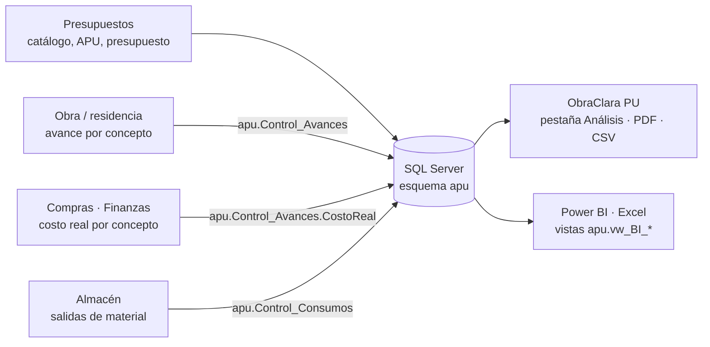

# Análisis de obra, reportes y conexión de departamentos

## Qué responde

| Pregunta | Dónde se ve | Cómo se calcula |
|---|---|---|
| ¿Dónde gana y dónde pierde la obra? | Pestaña **Análisis de obra** (barras), PDF, `vw_BI_Conceptos` | Margen proyectado − margen presupuestado, por concepto. |
| ¿Cómo va a terminar? | Tarjeta **Margen proyectado al terminar** | Costo proyectado = costo real + lo que falta × CD unitario / CPI, es decir, lo que falta se ejecuta con la eficiencia observada. |
| ¿Se está saliendo del alcance? | Tabla **Alcance** y tarjeta **Fuera de alcance** | Ejecutado − presupuestado: volumen que hay que cobrar como extraordinario o que se está regalando. |
| ¿Cuánto material se desperdicia? | Barras de **Desperdicio**, `vw_BI_Desperdicio` | Consumo real (almacén) − lo que el avance justifica con la merma del presupuesto. Se muestra en cantidad, en % y en pesos. |

Fórmulas con números verificados a mano en `AnalisisObraTests` (dominio) e implementadas igual en SQL (`fn_AnalisisConceptos`, `fn_AnalisisDesperdicio`). Una prueba exige que C# y SQL Server coincidan.

Los márgenes son sobre **costo directo**, antes de los indirectos de oficina, que no dependen de cada concepto.

## Cómo se conectan los departamentos

Todos escriben en **la misma base de SQL Server**. Cada quien aporta su parte, y el análisis se arma solo con lo que hay:



- **Cada captura guarda departamento, usuario y fecha.** La vista `apu.vw_BI_Capturas` dice quién reportó qué y cuándo, para saber qué área no ha alimentado la base.
- **Integridad:**
  - Un avance sólo puede ir a un concepto del presupuesto, nunca a un capítulo.
  - Un consumo sólo puede ser de un material del catálogo.
  - No se aceptan cantidades negativas.
- **Departamentos sin sistema todavía:** pueden mandar un CSV. Se importa desde **Importar avances / consumos** y se valida línea por línea. Si hay un error, no se importa nada y se indica qué línea corregir. Plantillas: [`plantillas/avances.csv`](plantillas/avances.csv) y [`plantillas/consumos.csv`](plantillas/consumos.csv).
  ```
  fecha,partida,cantidad,costo_real,nota          ← obra / compras
  fecha,insumo,cantidad,referencia                ← almacén
  ```
  También acepta `;` como separador, que es lo que exporta Excel con configuración regional en español.
- **Siguiente paso natural:** la app de campo de ObraClara (`apps/field`) ya captura avances con foto. Para conectarla, su API escribiría en `apu.Control_Avances`. Así el residente reporta desde la obra y el tablero se actualiza sin pasar por Excel.

## Descargas

| Botón **Exportar** | Contenido |
|---|---|
| Reporte de obra (PDF), también con Ctrl+P | Resumen con indicadores; dónde gana y pierde con barras; desperdicio; presupuesto y explosión de insumos. Tamaño carta, con colores ObraClara. |
| Presupuesto (CSV) | Árbol con nivel, concepto, cantidad, CD unitario, P.U. e importe. |
| Explosión de insumos (CSV) | Cantidades y costos por insumo, más herramienta y seguridad. |
| Análisis por concepto (CSV) | Avance, valor ganado, costo real, CPI, proyección, margen, variación y alcance. |
| Desperdicio de material (CSV) | Teórico, permitido, real, excedente y porcentajes. |

Los CSV van en UTF-8 con BOM, coma como separador y punto decimal. Excel los abre con acentos, y Power BI, Python o R los leen sin configuración.

El PDF usa QuestPDF con licencia **Community**: es gratuita para empresas con ingresos anuales menores a 1 millón de USD, y arriba de eso requiere licencia comercial.

## Power BI o Excel conectado a la base

1. En Power BI: **Obtener datos → SQL Server**, con el servidor y la base `ObraClaraApu`.
2. Elija las vistas:

   | Vista | Para qué |
   |---|---|
   | `apu.vw_BI_Conceptos` | Una fila por concepto y obra, con margen proyectado, variación y alcance. |
   | `apu.vw_BI_Desperdicio` | Una fila por material y obra. |
   | `apu.vw_BI_AvanceSemanal` | Avance, valor ganado y costo real por semana, para curvas S y tendencia. |
   | `apu.vw_BI_Capturas` | Bitácora por departamento. |
3. Filtre por la columna `Obra`. Con varias obras en la misma base, el tablero compara entre obras sin trabajo extra.

En Excel es igual: **Datos → Obtener datos → Desde base de datos → SQL Server**.
