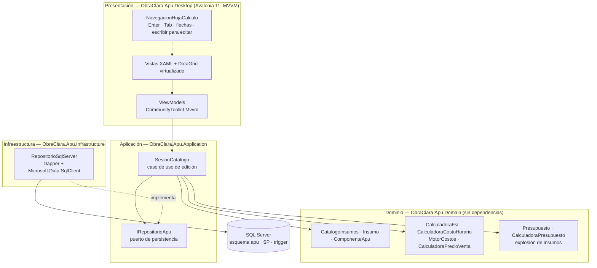
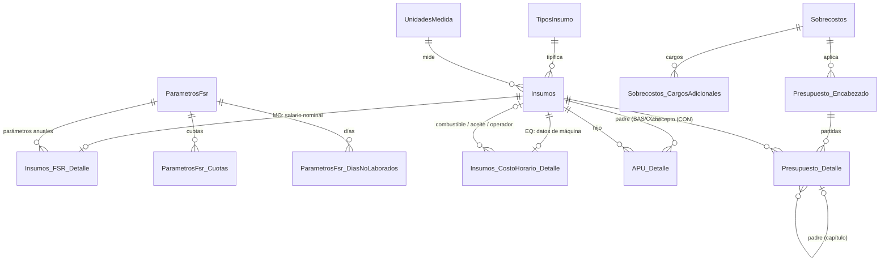

# ObraClara Precios Unitarios — Arquitectura y motor de cálculo

Aplicación de escritorio para Windows para presupuestar obra con **análisis de precios unitarios (APU)**, **explosión de insumos** y **pie de precio**. Sigue la metodología del Reglamento de la Ley de Obras Públicas y Servicios Relacionados con las Mismas (FSR, costo horario, indirectos, financiamiento, utilidad y cargos adicionales), la misma que usan Neodata, Opus o los tabuladores de la CMIC.

| Entregable | Dónde |
|---|---|
| Esquema DDL SQL Server | [`db/01_esquema.sql`](../db/01_esquema.sql) |
| Procedimientos, trigger anticiclos, cascada, presupuesto, explosión | [`db/02_programabilidad.sql`](../db/02_programabilidad.sql) |
| Datos de ejemplo (vivienda) · prueba de carga (40,000 insumos) | [`db/03_datos_ejemplo.sql`](../db/03_datos_ejemplo.sql) · [`db/04_carga_rendimiento.sql`](../db/04_carga_rendimiento.sql) |
| Dominio C#: entidades y calculadoras | [`src/ObraClara.Apu.Domain`](../src/ObraClara.Apu.Domain) |
| Interfaz Avalonia con grilla tipo hoja de cálculo | [`src/ObraClara.Apu.Desktop`](../src/ObraClara.Apu.Desktop) |
| Análisis de obra, PDF/CSV, conexión de departamentos | [`ANALISIS_Y_DEPARTAMENTOS.md`](ANALISIS_Y_DEPARTAMENTOS.md) · [`db/05_control_obra.sql`](../db/05_control_obra.sql) |
| Pruebas (54) | [`tests/`](../tests) |

---

## 1. Arquitectura



**Regla de dependencias:** el dominio no conoce a nadie. Aplicación depende del dominio. Infraestructura implementa los puertos de aplicación. Presentación compone todo.

### Decisiones

| Decisión | Por qué |
|---|---|
| **Dos motores con las mismas fórmulas: C# y T‑SQL** | La interfaz recalcula al instante en memoria (sin ir al servidor por cada tecla) y el servidor recalcula con procedimientos almacenados transaccionales, para importaciones, procesos nocturnos y otros clientes. Una prueba de integración exige que coincidan insumo por insumo; la diferencia medida es < 0.00001 $/unidad. |
| **Avalonia 11 en lugar de WPF** | Es nativo en Windows (Win32 + Skia, DPI por monitor), tiene DataGrid con virtualización de renglones y, sobre todo, se puede **probar sin pantalla** (Avalonia.Headless): la navegación con teclado se valida en CI. WPF es igual de válido; la capa de dominio y aplicación no cambia. |
| **Decimal en todo el cálculo** | `decimal` en C# (28 dígitos) y `decimal(19,6)` / `decimal(19,8)` en SQL. Nunca `float` para dinero. Las tasas se guardan como fracción (0.03 = 3 %); las cuotas IMSS con 8 decimales porque la prima de riesgo tiene 7 (0.0758875). |
| **Desglose persistido** | Cada insumo guarda material, MO, equipo, herramienta y seguridad. Permite reportes por tipo de costo sin recalcular y es lo que permite la regla de "herramienta sin doble cobro" (§ 3.3). |
| **Cargos de herramienta y seguridad como % de MO por compuesto** | Es la práctica común (3 % herramienta, 2 % seguridad). El motor evita cobrarlos dos veces cuando un básico ya los aplicó. |

---

## 2. Modelo de datos (SQL Server)



### Integridad referencial estricta

- **Subtipos con FK compuesta.** `Insumos` tiene `UNIQUE (InsumoId, TipoInsumoId)`. `Insumos_FSR_Detalle` lleva la columna calculada persistida `TipoInsumoId = 2` y una FK `(InsumoId, TipoInsumoId)`. Así **es imposible** colgar un FSR de un material o un costo horario de un concreto. Con el mismo truco, el combustible de una máquina sólo puede ser un MAT, su operador sólo un MO y una partida de presupuesto sólo puede apuntar a un CON.
- **Matrices.** PK `(PadreId, HijoId)`, `CHECK PadreId <> HijoId`, rendimiento o cantidad positivos y merma en [0, 1). El trigger `trg_APU_Detalle_Validar` exige que el padre sea compuesto, impide usar un concepto como componente y **rechaza ciclos** (§ 3.5).
- **Presupuesto.** La FK al padre es `(PresupuestoId, PadrePartidaId)`: una partida no puede colgar de otro presupuesto. Hay un CHECK de forma: el concepto lleva insumo y cantidad; el capítulo y el subcapítulo no; la raíz es un capítulo.

### Índices para lecturas masivas

| Índice | Uso |
|---|---|
| `PK_APU_Detalle` clúster `(PadreId, HijoId)` | Leer una matriz es un rango contiguo del clúster. |
| `IX_APU_Hijo (HijoId) INCLUDE (PadreId, CantidadEfectiva)` | Cascada hacia arriba ("¿dónde se usa este insumo?") sin búsquedas adicionales. |
| `IX_Insumos_Tipo (TipoInsumoId, Clave) INCLUDE (Descripcion, UnidadId, CostoDirecto, Activo)` | Grillas del catálogo y búsquedas por tipo, cubiertas por el índice. |
| `IX_CH_Combustible/Lubricante/Operador` (filtrados) | Qué máquinas recalcular cuando cambia el diésel o el salario del operador. |
| `CX_PresDet_Arbol (PresupuestoId, PadrePartidaId, Orden)` clúster | El árbol del presupuesto se lee en el orden en que se muestra. |

---

## 3. Motor de cálculo

Todas las cifras de esta sección son las del catálogo de ejemplo y están verificadas por pruebas.

### 3.1 Factor de Salario Real (`CalculadoraFsr`)

```
Tp  = días calendario + aguinaldo + vacaciones × prima vacacional          (días pagados)
Tl  = días calendario − Σ días no laborados                                 (días laborados)
SBC = min(Sn × Tp / días calendario , 25 UMA)                               (salario base de cotización)
Cuotas anuales = Σ tasa × base,  con base según la cuota:
      SBC × 365  ·  UMA × 365  ·  (SBC − 3 UMA)⁺ × 365  ·  Sn × Tp (impuesto sobre nómina)
Ps  = cuotas anuales / (Sn × Tp)
FSR = Ps · (Tp/Tl) + Tp/Tl                                                  (art. 191 del Reglamento)
Salario real = Sn × FSR   ≡  (Sn·Tp + cuotas) / Tl
```

Peón con salario nominal de $400:

| Tp | Tl | SBC | Cuotas anuales | Ps | FSR | Salario real |
|---|---|---|---|---|---|---|
| 383 | 288 | 419.73 | 47,412.60 | 0.30948 | **1.741428** | **$696.57 / jornada** |

Los días no laborados son: domingos 52, festivos 7, vacaciones 12, mal tiempo 3, costumbre 2 y enfermedad 1. Las cuotas del ejemplo son ilustrativas. La de cesantía y vejez es progresiva según el rango de SBC; hay que capturar las tablas vigentes.

### 3.2 Costo horario de maquinaria (`CalculadoraCostoHorario`)

```
Vm = Va − llantas − piezas especiales        Vr = Vm · r
D  = (Vm − Vr) / Ve                          Im = (Vm + Vr)/(2·Hea) · i
Sm = (Vm + Vr)/(2·Hea) · s                   Mn = Ko · D
Co = HP · Fo · coef. combustible · Pc        Lb = (Ah + C/t) · Pa
N  = llantas / Vn                            Ae = piezas / Va
Po = salario real del operador / Ht
Costo horario = (D + Im + Sm + Mn) + (Co + Lb + N + Ae) + Po
```

Revolvedora de 1 saco (8 HP, diésel): D 12.75 + Im 4.68 + Sm 1.17 + Mn 7.65 + Co 21.87 + Lb 3.00 + Po 118.57 = **$169.69/hr**. El combustible, el aceite y el operador son insumos del catálogo. Si sube el diésel o el salario del operador, la máquina se recalcula en la cascada.

### 3.3 Costo directo de una matriz (`MotorCostos.EvaluarMatriz`)

```
cantidad efectiva = (1 / rendimiento  ó  cantidad) × (1 + merma)
CD = Σ cantidad efectiva × CD del componente  +  herramienta  +  equipo de seguridad
herramienta = tasa × MO pendiente      (igual para equipo de seguridad)
```

**Sin doble cobro.** Cada insumo arrastra su "mano de obra pendiente" de cada cargo. Si un básico ya aplicó herramienta, su MO sube al padre como *ya cargada*. Ejemplo verificado:

| | Material | MO | Herramienta | CD |
|---|---|---|---|---|
| Mortero (cemento 1 + peón 0.5 jor, herr. 3 %) | 100 | 100 | 3.00 | 203.00 |
| Muro (2 m³ mortero + 0.25 jor peón, herr. 3 %, seg. 2 %) | 200 | 250 | 6 heredada + 1.5 propia | **462.50** (con seguridad 5.00) |

Cobrar el 3 % sobre los 250 de MO daría 7.50 de herramienta propia en lugar de 1.50 y cobraría dos veces la del mortero.

### 3.4 Recursión, orden y cascada (C#)

1. **Grafo de dependencias.** Las aristas van del compuesto a sus componentes y de la máquina a su combustible, aceite y operador.
2. **Orden topológico con DFS iterativo.** Usa pila explícita, así que no desborda con 20,000 niveles (hay prueba). Un nodo "en proceso" que vuelve a aparecer es un ciclo, y se reporta la ruta: `C → A → B → C`.
3. **Recálculo incremental.** Ante un cambio, `Ancestros()` hace un BFS inverso y sólo se reevalúan esos insumos, en orden topológico.
4. **Prevención.** `CatalogoInsumos.AgregarComponente` busca si el hijo ya llega al padre antes de crear la arista. El catálogo nunca queda con un ciclo.

### 3.5 Recursión y cascada (SQL Server)

- **`trg_APU_Detalle_Validar`** trabaja en dos fases:
  1. Un BFS **por nodos** desde todos los hijos insertados. Si ningún padre insertado es alcanzable, no hay ciclo. Es el caso de toda importación de conceptos, porque nadie llega a un concepto.
  2. Sólo para las aristas sospechosas, una CTE recursiva exacta.
  
  Con esto, cargar 136,000 renglones de matriz con el trigger activo toma 3.3 s.
- **`usp_RecalcularCascada`** tiene tres pasos:
  1. Calcula los afectados: semillas más sus ancestros, por BFS sobre `vw_Dependencias`.
  2. Recalcula por **niveles** (Kahn). En cada vuelta toma los afectados cuyas dependencias ya no están pendientes y los calcula con **una sentencia set-based por tipo**: MAT, MO con FSR, EQ con costo horario y compuestos.
  3. Si quedan pendientes y ninguno está listo, hay un ciclo y lanza `THROW`.

  Todo ocurre en una transacción con `XACT_ABORT` y `sp_getapplock`, para que dos cascadas simultáneas no se mezclen.
- **`usp_ActualizarPrecioInsumo`** cambia el precio y ejecuta la cascada en la misma transacción.
- **`usp_CalcularPresupuesto`** calcula el PU y el importe por concepto con `fn_PieDePrecio`. Después suma por capítulo con una CTE de ancestros.
- **`usp_ExplosionInsumos`** usa una CTE recursiva que multiplica volumen × cantidades efectivas a lo largo de la cadena y consolida por insumo elemental.

### 3.6 Pie de precio (`CalculadoraPrecioVenta`, `fn_PieDePrecio`)

```
I  = CD · (indirecto oficina central + indirecto de campo)
F  = (CD + I) · financiamiento
U  = (CD + I + F) · utilidad bruta
PU = (CD + I + F + U) / (1 − Σ cargos adicionales)     → redondeado a centavos
```

Con CD = $100 y sobrecostos de 8 % + 4 % de indirectos, 1.2 % de financiamiento, 10 % de utilidad, 5 al millar de inspección y 2 al millar de la CMIC, el **PU es $125.56**.

Calculadoras auxiliares:
- **Indirectos:** Σ rubros / CD total.
- **Utilidad bruta:** neta / (1 − ISR − PTU). Por ejemplo, 10 % neta con ISR 30 % y PTU 10 % da 16.67 %.
- **Financiamiento:** con el flujo de caja de la obra, Σ max(0, −saldo acumulado) × tasa del periodo / Σ egresos.

### 3.7 Presupuesto y explosión (`CalculadoraPresupuesto`)

- **Árbol:** capítulo → subcapítulo → concepto. El importe de cada concepto es volumen × PU de venta, y los padres suman a sus hijas.
- **Explosión:** cada compuesto se reduce **una vez** a su receta elemental por unidad (memoizada) y después se multiplica por los volúmenes.
- **Invariante probado:** Σ cantidad × costo de los elementales + herramienta + seguridad = Σ volumen × CD de los conceptos.
- **Presupuesto de ejemplo:** CD $206,206.79, total $258,907.05 sin IVA. SQL Server y C# coinciden al centavo.

---

## 4. Interfaz: grilla de alta velocidad tipo hoja de cálculo

| Necesidad | Cómo se resuelve |
|---|---|
| Miles de renglones fluidos | `DataGrid` de Avalonia con virtualización de renglones. El presupuesto se muestra como **lista plana con sangría**, no como árbol anidado, para que la virtualización funcione con decenas de miles de partidas. El filtro del catálogo usa `DataGridCollectionView.Filter`, sin reconstruir la colección. |
| Recálculo reactivo | Al confirmar una celda, `SesionCatalogo` aplica el cambio al dominio y ejecuta `MotorCostos.Recalcular` sólo sobre los afectados. Luego notifica sus ids, y únicamente esos renglones disparan `PropertyChanged`. 40,000 insumos se recalculan completos en ~0.1 s; una cascada típica tarda ~30 ms. |
| Edición en sitio | Columnas editables con `UpdateSourceTrigger=LostFocus`: el valor se confirma al salir de la celda, **no en cada tecla**. Una prueba detectó que con confirmación por tecla, escribir "0.5" pasaba por "0", el dominio lo rechazaba y se perdía la edición. |
| Errores de regla | Una cantidad negativa, un ciclo o una clave inexistente aparecen en la barra de estado. **Sólo ese renglón** vuelve a su valor guardado; el resto de la grilla no se recarga. |
| Persistencia sin bloquear | La parte local es síncrona e inmediata, y la escritura a SQL Server termina en segundo plano. Si el servidor rechaza el cambio, se recarga desde la base para no divergir. |

**Tema "ObraClara clásico".** La apariencia sigue la de los programas de precios unitarios de escritorio, con identidad propia de ObraClara (no usa marcas ni logotipos de terceros):
- Paleta azul pizarra `#17375E` con acento ámbar `#F2A900`.
- Grillas densas de 26 px con encabezados azules y renglones alternos.
- Tipo de insumo por color: MAT azul, MO verde, EQ naranja, BAS morado y CON azul marino.
- Tarjetas de costo directo y P.U. de venta, y barra inferior con C.D., P.U. y total del presupuesto.

Los colores están definidos en `App.axaml`.

**Forma de trabajo con teclas de función** (`Views/MainWindow.axaml.cs`, probada con teclado simulado):

| Tecla | Acción |
|---|---|
| F3 | Buscador de insumos: escribir filtra, ↑ ↓ eligen y Enter agrega a la matriz con cantidad 1. No ofrece conceptos ni el propio insumo. |
| F4 / doble clic | Entra a la matriz del básico (matriz dentro de matriz). En el presupuesto, abre la matriz del concepto. |
| Esc / Alt+← | Cancela la edición o, si no se edita, regresa a la matriz anterior. La ruta se muestra arriba, p. ej. `CON-FIR10 › BAS-CON150 › BAS-CUA1`. |
| F9 | Recalcula todo el catálogo y el presupuesto. |
| F1 | Tabla de atajos. |
| Ctrl+1/2/3 | Catálogo, presupuesto o explosión. |

**Teclado dentro de la grilla** (`Comportamientos/NavegacionHojaCalculo.cs`, probado con teclado simulado):

| Tecla | Acción |
|---|---|
| Cualquier carácter | Empieza a editar la celda con lo tecleado (sin F2 ni doble clic). |
| Enter / Shift+Enter | Confirma y baja o sube. En el último renglón crea uno nuevo. |
| Tab / Shift+Tab | Confirma y avanza entre columnas editables, y cambia de renglón en el borde. |
| ↑ ↓ (editando) | Confirma y se mueve, como en Excel. |
| Supr | Quita el renglón. |
| Esc | Cancela la edición. |
| Ins | Agrega un insumo a la matriz. |
| Ctrl+F | Va al buscador. |

En el renglón nuevo se escribe la **clave** del insumo (sin distinguir mayúsculas). La descripción, la unidad, el tipo y el costo se completan solos.

**Si se prefiere WPF:** las capas de dominio y aplicación no cambian. Conviene usar un grid con virtualización de filas y columnas (el DataGrid nativo con `EnableRowVirtualization`, o uno comercial como DevExpress, Syncfusion o Telerik). El comportamiento de teclado se porta casi línea por línea a un `Behavior` de WPF.

---

## 5. Rendimiento medido

Medido en un contenedor Linux de 4 núcleos con SQL Server 2022.

| Escenario | C# (memoria) | SQL Server |
|---|---|---|
| Catálogo de 40,000 insumos y ~136,000 renglones de matriz: recálculo completo | 106 ms | 0.9 s |
| Cambio de precio del material más usado: cascada | 668 insumos en 27 ms | 1,303 insumos en 0.28 s |
| Carga masiva de matrices con el trigger anticiclos activo | — | 136,000 renglones en 3.3 s |

Los catálogos de prueba de C# y de SQL son sintéticos y distintos, por eso los conteos de la cascada difieren. Para reproducirlo: `RendimientoTests` y `db/04_carga_rendimiento.sql`.

## 6. Pruebas (54)

| Proyecto | Qué cubre |
|---|---|
| `Domain.Tests` (24) | FSR, costo horario y sobrecostos **verificados a mano**; herramienta sin doble cobro; cascada incremental (sólo afectados, en orden); ciclos con ruta; 20,000 niveles sin desbordar; reglas de tipo; presupuesto y explosión con su invariante; rendimiento. |
| `Infrastructure.Tests` (11, contra SQL Server real) | Que **SQL y C# coincidan** en cada insumo, presupuesto, explosión y análisis de obra; PDF y CSV; importación de avances con validación por línea; que el script de datos sea igual al catálogo de ejemplo; la cascada por precio, por matriz y por herramienta; y que el trigger rechace ciclos y conceptos como componente. |
| `Desktop.Tests` (19, Avalonia sin pantalla) | Recálculo reactivo en la vista; tablero de análisis, exportación e importación; captura de claves; rechazo de ciclos; teclado en la grilla (escribir sobre una celda, Enter, Tab y Shift+Tab, nuevo renglón, Supr y Esc); navegación entre matrices con F4 y Esc; buscador F3; F1 y F9. |

## 7. Pendiente / siguiente iteración

- Pantallas de captura de parámetros de FSR, costo horario y sobrecostos (hoy se cargan por SQL o en código).
- Edición del presupuesto desde la interfaz (hoy es de consulta) e importación de presupuestos de Excel u Opus.
- Concurrencia optimista con la columna `Version` (rowversion), ya incluida en el esquema.
- Costo horario en espera o reserva y otras fuentes de energía; explosión de combustibles derivada de las horas-máquina.
- Tablas de cuotas IMSS por rango de SBC (cesantía y vejez progresiva) y catálogo de ISN por estado.
